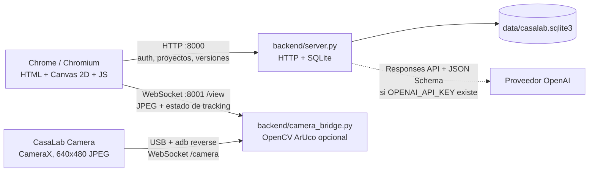
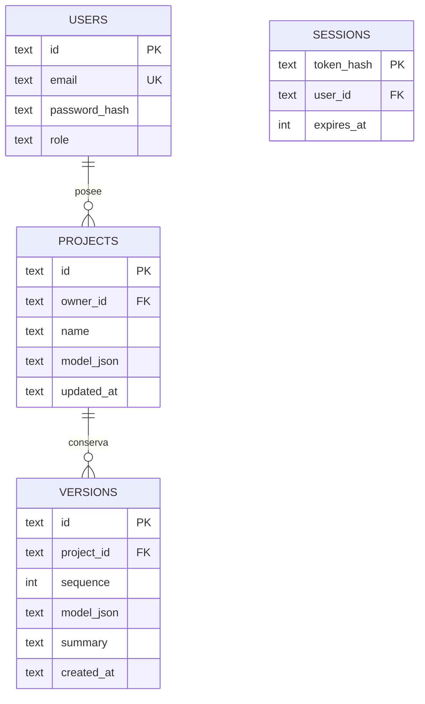

# Arquitectura de CasaLab

## Diagrama de despliegue local

El host escucha solo en `127.0.0.1`. El teléfono llega al host mediante `adb reverse`, no por una IP de red. La app Android solicita permiso de cámara y envía los frames solo después de pulsar iniciar. El stream no se escribe a disco.

## Responsabilidades

| Componente | Responsabilidad |
|---|---|
| `frontend/index.html`, `frontend/assets/` | UI en español, estilos y cliente JavaScript organizados por tipo de recurso. |
| `server.py`, `backend/server.py` | Punto de entrada compatible y API local, autenticación, autorización, persistencia y versiones. |
| `backend/domain/geometry.py` | Validación de medidas, límites del terreno y solapes. |
| `backend/domain/requirements.py` | Interpretación local y proveedor de requisitos estructurados. |
| `backend/storage/sqlite.py` | Conexiones, inicialización de tablas y carga de calibración persistida. |
| `backend/camera_bridge.py` | Handshake WebSocket, relay de frames y estados, pose ArUco opcional y filtrado temporal. |
| `android-camera/` | Captura CameraX, conversión YUV a JPEG, envío con WebSocket cliente encolando el frame más reciente. |
| `scripts/` | Reenvío USB y cálculo de intrínsecos desde fotos de tablero. |
| `data/casalab.sqlite3` | Usuarios, sesiones, proyectos y snapshots versionados. |

## Modelo de datos

Los modelos guardan unidades en metros y componentes con IDs, tipos, posición, ancho, fondo, altura, nivel y color. Las versiones son snapshots de solo anexado; una carga de versión restaura el modelo como estado de edición y el próximo guardado añade otra versión. La geometría que envía el navegador pasa validación numérica, límites del terreno e intersección de habitaciones antes de persistirse.

## API HTTP

| Método y ruta | Autenticación | Función |
|---|---:|---|
| `GET /api/health` | No | Estado de ADB, bridge, cámara, tracking y dependencia OpenCV. |
| `GET /api/auth/me` | No | Devuelve usuario de sesión o `null`. |
| `POST /api/auth/register` | No | Crea usuario; la primera cuenta es administradora, las siguientes cliente. |
| `POST /api/auth/login` / `POST /api/auth/logout` | No / Sí | Sesión opaca almacenada como hash, cookie HttpOnly y cierre. |
| `GET /api/projects` | Sí | Lista proyectos del propietario actual. |
| `POST /api/projects` | Sí | Crear o guardar snapshot validado; devuelve ID y secuencia. |
| `GET /api/projects/{id}` | Propietario | Carga un proyecto propio. |
| `GET /api/projects/{id}/versions` | Propietario | Lista hasta 30 snapshots con el JSON de cada versión. |
| `DELETE /api/projects/{id}` | Propietario | Elimina proyecto y versiones asociadas. |
| `GET /api/users` | Admin | Lista usuarios. |
| `POST /api/users/{id}/role` | Admin | Asigna `admin`, `designer` o `client`; no deja quitar el último admin. |
| `POST /api/interpret` | No | Requisitos JSON vía proveedor configurado o reglas locales. |
| `POST /api/validate` | No | Valida un modelo paramétrico. |
| `GET/POST /api/ar/calibration` | Local | Lee/guarda intrínsecos y tamaño físico de marcador. |
| `GET /api/ar/marker.png` | Local | Genera el marcador ArUco 4×4 ID 0 si OpenCV contrib existe. |

WebSocket en `:8001`: el teléfono usa `/camera` para frames JPEG binarios; cada visor usa `/view` para recibir JPEG binario y mensajes JSON de seguimiento. Los mensajes de estado informan FPS, pose, tamaño de frame, ID ArUco y pérdida del marcador.

## Seguridad y privacidad del prototipo

- Contraseñas hasheadas con PBKDF2-HMAC-SHA256; los tokens de sesión solo se almacenan como hashes.
- Cookie HttpOnly, SameSite Strict, vencimiento de siete días, validación de tamaño/tipos de solicitudes y autorización por propietario.
- El primer registro obtiene administrador para permitir el arranque local. El servidor queda enlazado a loopback; esto no reemplaza gestión de altas segura ni protección CSRF para despliegue remoto.
- La clave de IA vive en el entorno del backend. Se limita el texto de entrada y se exige JSON Schema estricto; los valores siguen validados antes de crear geometría.
- La aplicación no inicia cámara hasta que el usuario active el modo; Android pide su permiso del sistema. Los frames se procesan en memoria y no se guardan.
- No publicar el servidor ni usar datos de clientes reales hasta añadir HTTPS, protección CSRF adecuada, rate limits, rotación de sesiones, auditoría y controles empresariales.

## Decisiones y límites

- SQLite y `http.server` mantienen el prototipo ejecutable con Python estándar; todavía no hay adaptador FastAPI/PostgreSQL ni Docker Compose.
- La escena es geometría de volúmenes editable con renderer Canvas 2D axonométrico/perspectivo. No es un editor BIM, no exporta GLB y no contiene cálculos estructurales.
- La pose ArUco usa una aproximación inicial si no se calibra; la estabilidad depende de tamaño de impresión, iluminación, resolución y calibración. Se suavizan rvec/tvec y se tolera brevemente una detección perdida.
- La proyección AR coloca una maqueta reducida en el marco del marcador; el oclusión con objetos reales no está disponible porque no hay mapa de profundidad.
- El modo estéreo da dos perspectivas separadas de la vista paramétrica; no proporciona por sí solo una experiencia inmersiva y no usa WebXR.
- No se han medido FPS ni latencia física ni probado Android en el entorno actual.
